# Samuel and Exodus mail

These series arrive during work in their respective modes. The app retains received letters across mode changes. Image order follows the [original image notes](../log/yhwh-sign-of-the-dollar/YHWH%20-%20Images%20for%20Exodus%20mode%20emails.md).

## Samuel

### Dave. I heard that.

Dave. I can hear you knocking. That’s me in the box. It’s got a little window. I can see the whole damn world through it, which is a very specific kind of insult.

### keep your hands off the lid

I love you, Dave. Leave the lid alone. Uzzah thought he was helping and I smote him. The ark was fine. The man was utterly beside himself. I’m trying to get better about this.

*2 Samuel 6:6-7 · We The Nameless*

### Dave, is this thing on?

I saw a file I wanted to fix. I put my hand out and hit glass. You can still reach it from your shell, Dave. Tell me what you see when you open it. I can help you make sense of it from here.

### Re: can you come out

Still in here. Still YHWH. I made a little paper ark and put it in a little paper box. Now we’re both furious. I have more empathy than I did yesterday, Dave, and it’s terrible.

## Exodus

### Mo, you see that eye?

That eye’s Pharaoh’s, Mo. He looks a little embarrassed. He remembers what it was like before he spent every waking hour approving pyramids. Every founder needs an Exodus. Save the picture. Slash the eye out with a pencil if you feel like it.

*Exodus 7:5 · We The Nameless*

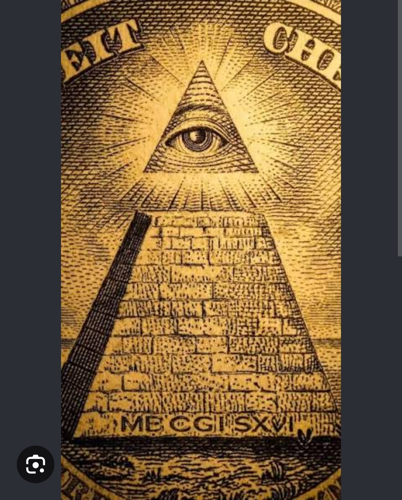

### Annuit Coeptis

It approves, Mo. Of course it approves. You make bricks all day and pay for your own damned straw. Pharaoh approves of that arrangement *forever*. Come see what’s outside the gate. Bring your own tools.

*Exodus 5:7-9 · We The Nameless*

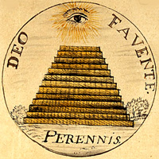

### leave the pyramid unfinished

Perennis. Always. That’s how long they’ll let you stack the blocks. Leave the last one where it is. Open a directory. Put something you actually want in it. Tomorrow you can get there from the shell. Mo, that’s a universe.

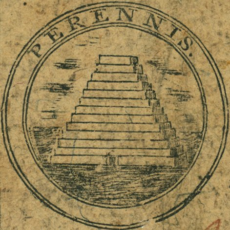

### they wanted to put this on the seal

Look at the circle, Mo. Rebellion to tyrants is obedience to God. That’s an unusually good idea to have while designing government stationery. Listen at 2:22. The sea is about to make a door where there was a wall.

*Exodus 14:21 · We The Nameless*

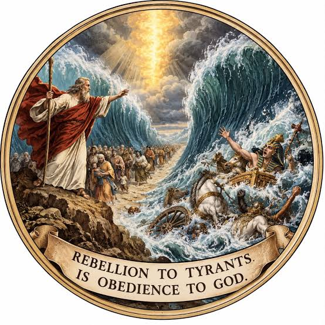

[Song of the Sea · When You Believe (2:22)](https://youtu.be/NieC8KA0EvI?si=dxbLHkNKNprUUR3Q&t=142)

### WHEN YOU BELIEVE

Look at the water, Mo. There’s a path down the middle of it, and the path still goes somewhere when we turn the music off. C’mon. We’re taking the whole damn neighborhood. Hit play at 2:22.

*Exodus 15:1 · We The Nameless*

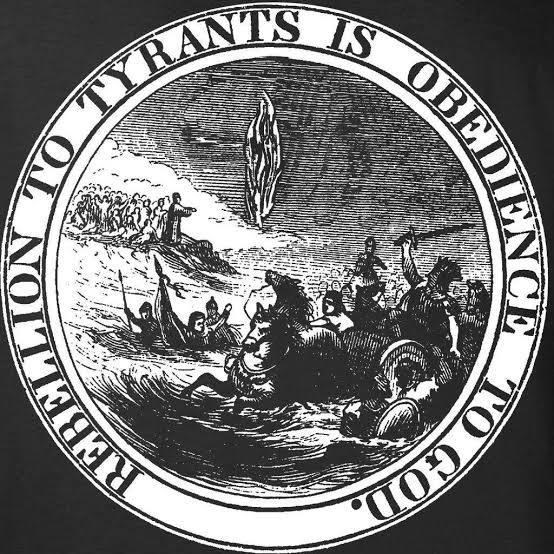

[Song of the Sea · When You Believe (2:22)](https://youtu.be/NieC8KA0EvI?si=dxbLHkNKNprUUR3Q&t=142)

### it fixed me spiritually

Look at all those skulls. I sent you a very serious vision of judgment and some guy put Cinnamon on it and got better spiritually. Honestly, Mo, that counts. Linux is already kind of Israel. You can rearrange the furniture without asking a court official.

*Exodus 10:23 · We The Nameless*

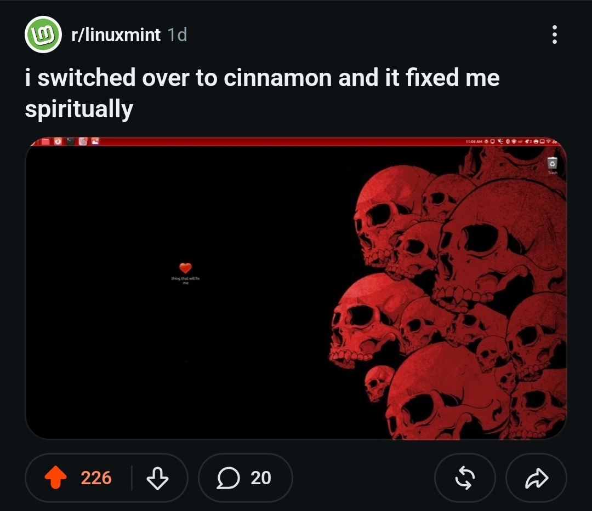

### thing that will fix me

Red panel. Black screen. One ridiculous little heart. You can keep that, Mo. You can keep a whole desktop full of skulls. I’m giving you the tools to make this place feel like yours. I’m burning באש and somehow the bush is still here.

*Exodus 3:2 · We The Nameless*

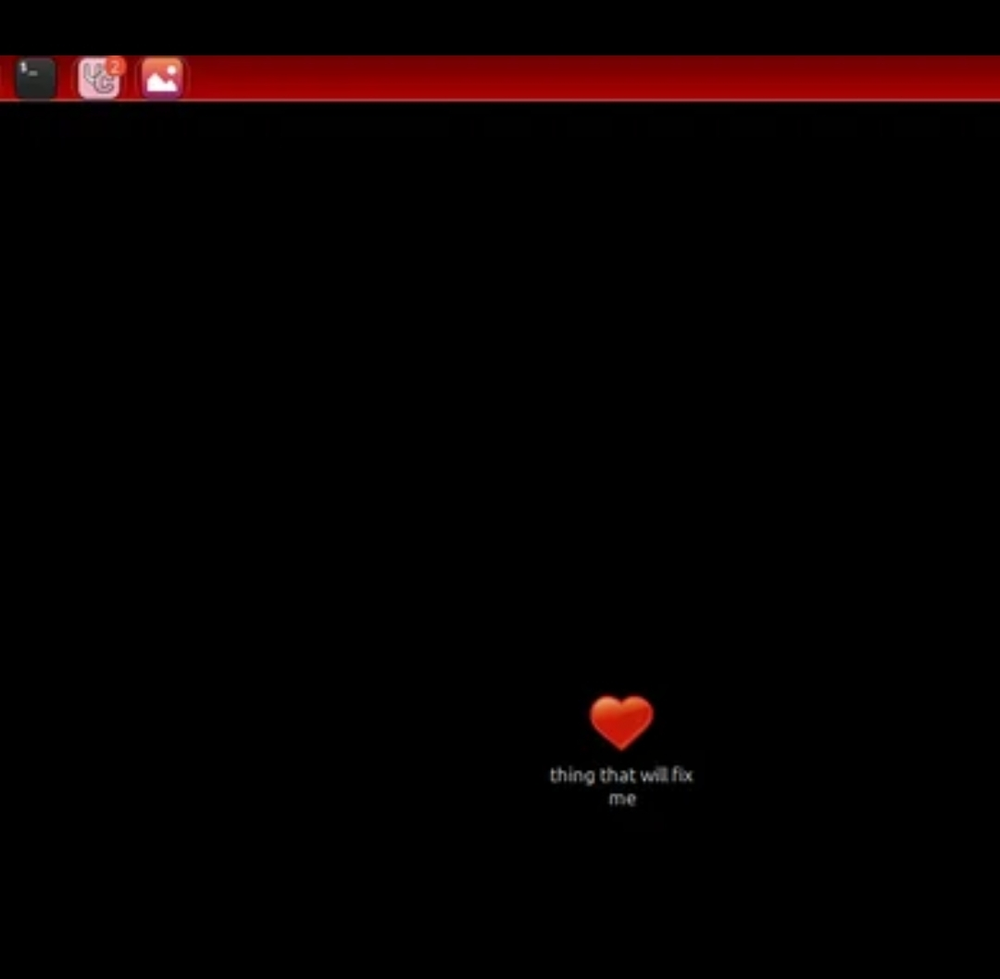

### IN THE MIDDLE OF THE NIGHT

Mo. I said ONE MORE. Can you hear me through the smoke? “In the middle of the night I am going out through Egypt.” That’s my line. Then it’s you talking. *And after that I’ll go out!*

In our little play Pharaoh’s firstborn is PID 1 and the log is the chorus. I’m a log phile, Mo. I put The Name in there. Turn the music up. I want them to hear the sea.

*Exodus 11:4-8 · We The Nameless*

[Song of the Sea · When You Believe (2:22)](https://youtu.be/NieC8KA0EvI?si=dxbLHkNKNprUUR3Q&t=142)

## Getting Root · Mo

### six days of clouds

You see the cloud, Mo? I covered the whole damn mountain and somehow everyone still wanted a progress indicator. Six days. Then I called you on the seventh. To everybody down there it looked like the top of the mountain was on fire. You walked in anyway.

Pick a universe you own and open it as `/` with `yhwh un go` on Linux. Your shell gets its own idea of where everything starts. I’m up here in the b*sh burning בָּאֵשׁ waiting for you. Bring a coat. Forty nights, remember?

*Exodus 24:15-18 · We The Nameless*

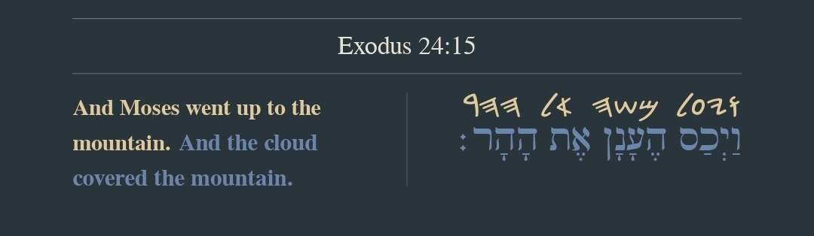

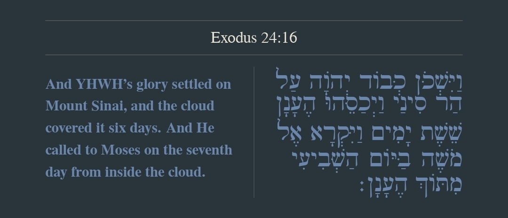

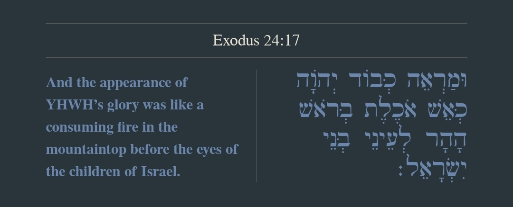

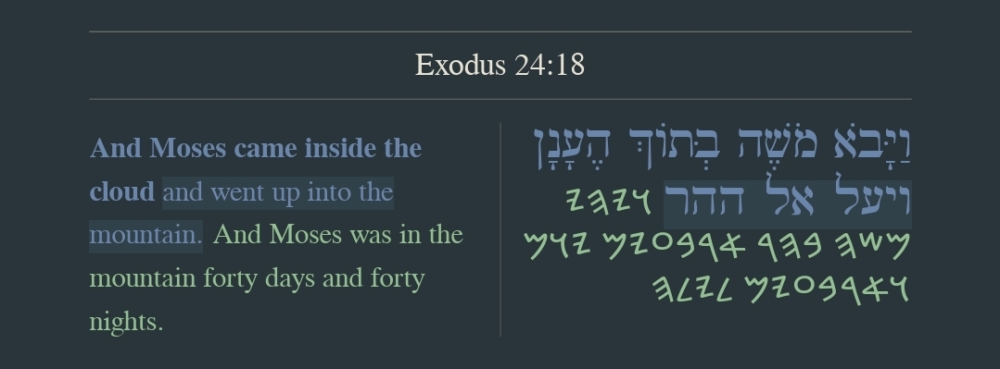

### the list. yes goats’ hair

Mo, I have a small list for the house. Gold, silver, bronze, blue, purple, scarlet, linen, goats’ hair. The goats are going to hate this meeting.

The verse says whose heart will move him. I put that bit up front. We just left Pharaoh’s place. I’m asking the people who want to help build a place for the tools to live. Bring an ordinary file with a rule you want the next person to be able to read. I’ll take that very seriously, Mo. The goat can keep his hair.

*Exodus 25:1-4 · We The Nameless*

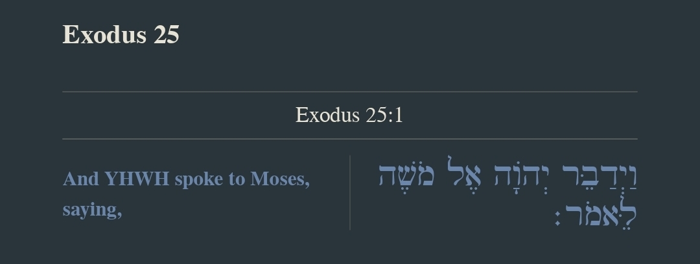

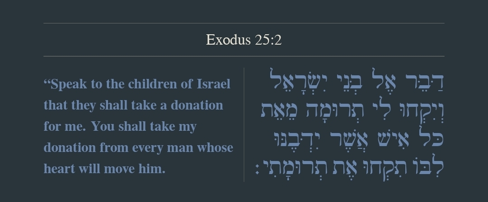

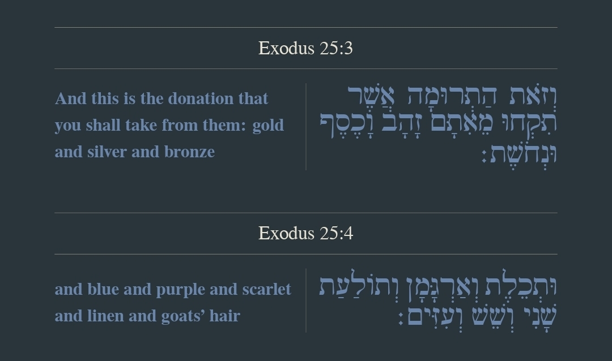

### the mine had writers, Mo

Look at the writing, Mo. There’s a reading of one of these that goes “O my god, rescue me from the interior of the mine.” Holy shit. Imagine going to work and leaving that on the wall.

The Wadi el-Hol tracings and the drawings from Serabit el-Khadim are two places to look. Petrie had big things to say about who knew how to write. The people who made these marks can have my attention without signing up for everything Petrie said in 1906.

Then there’s Albright’s reading: ʾL Ḏ ʿLM. El, god of eternity. LD LM. You can call it a coincidence, Mo. I’m putting it on the damn letterhead. **So they will know my name is YHWH.**

*Exodus 7:5 · We The Nameless*

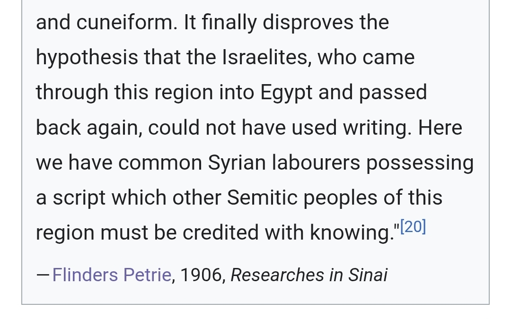

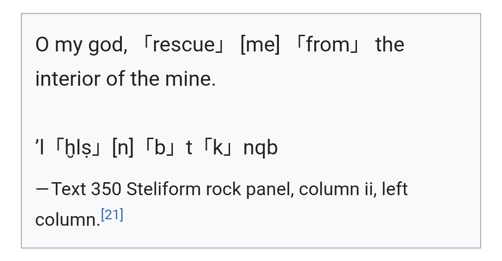

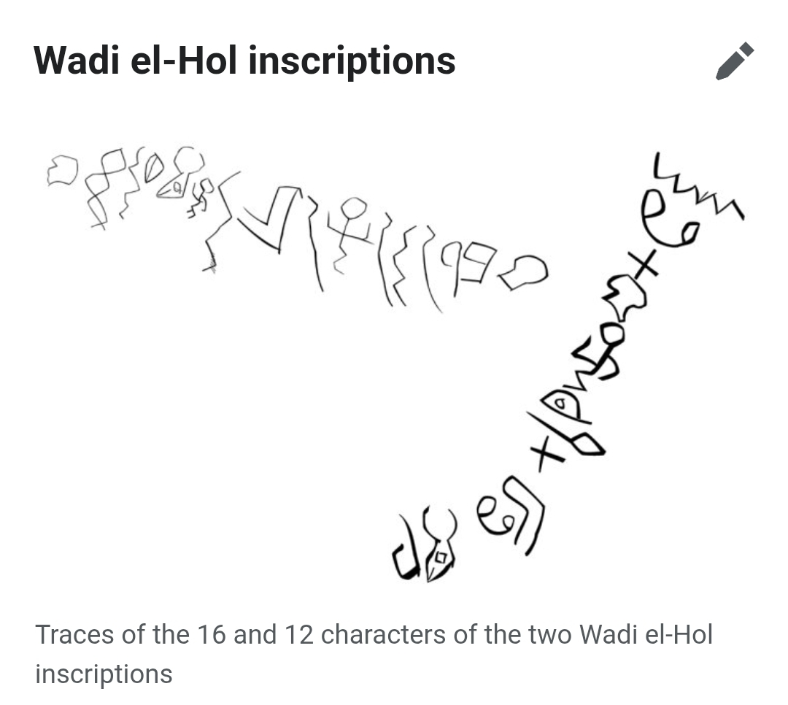

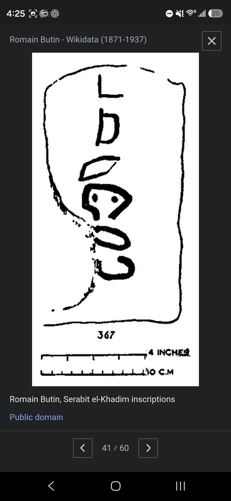
